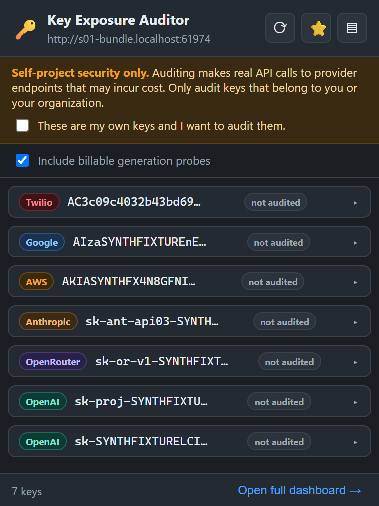
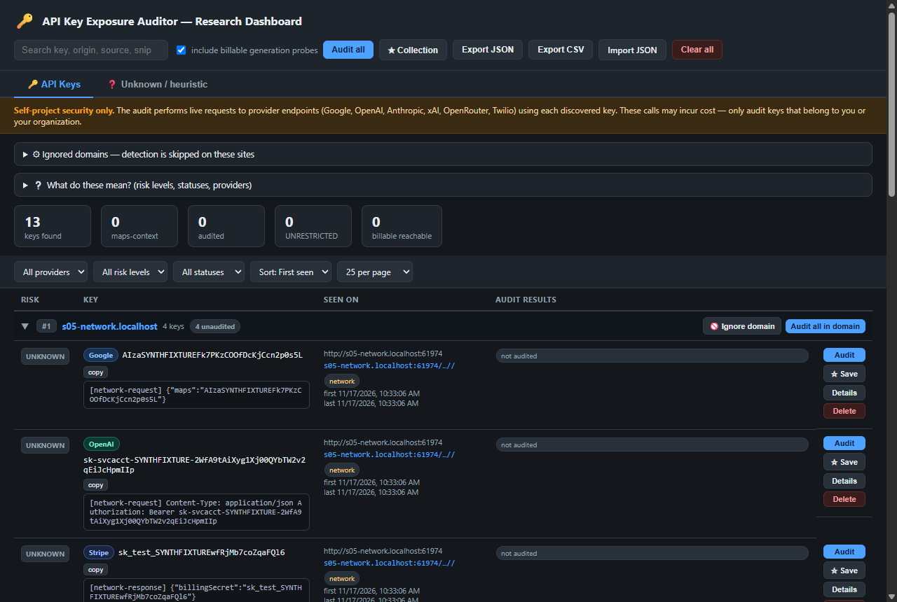

<p align="center">
  
</p>

# API Key Exposure Auditor

[](https://github.com/hasif5/api-key-exposure-auditor/actions/workflows/release.yml)
[](https://github.com/hasif5/api-key-exposure-auditor/releases/latest)
[](./LICENSE)
[]()
[](https://github.com/hasif5/api-key-exposure-auditor/stargazers)

**Browser extension that helps you find API keys accidentally exposed in your own web projects -- before someone else does.**

Point it at your own site, app, or localhost and it passively detects leaked credentials across the DOM, JavaScript bundles, source maps, network traffic, and more. Then audit each key in one click to see what it can reach and whether it's properly restricted.

Live-validated providers: **Google**, **OpenAI**, **Anthropic**, **OpenRouter**, **xAI**, **Twilio**, **AWS**, **GitHub**, **GitLab**, **Slack**, and **Stripe**. On top of that it heuristically flags 20+ other token shapes (SendGrid, npm, Shopify, HuggingFace, Stripe webhook secrets, Discord/Telegram bots, JWTs…), connection strings with embedded credentials, and full private-key blocks. All data stays local, no backend, no telemetry.

> If this tool helps you secure your projects, consider giving it a star -- it helps others find it.

<!-- Side by side via a table: fixed pixel widths overflow GitHub's README column and stack. Widths follow the aspect ratios (popup 380x507, dashboard 1280x860) so both come out about the same height. -->
<table align="center">
  <tr>
    <td width="33%" valign="top">
      
    </td>
    <td width="67%" valign="top">
      
    </td>
  </tr>
</table>

<p align="center"><sub>The popup (current tab) and the dashboard (all findings), captured from the real extension on a local test page. Every key shown is synthetic. Detection only: no audit was run, so risk shows as unknown. Reproduce with <code>node research/harness/capture-readme-shots.mjs</code>.</sub></p>

---

## Security Research & Case Studies

Detection and risk-classification claims in this project are backed by a reproducible study that runs the real extension in Chromium against a local fixture site that serves only synthetic credentials. Nothing in it touches a real provider or a real secret.

**[Case study 001: credential exposure across client-side surfaces](research/001-credential-exposure.md)** (completed 2026-11-17, extension v1.13.0)

| Measured on the 14-origin synthetic corpus | Result |
|---|---|
| Declared exposures detected with correct provider, path and origin | 36 of 36 |
| Predicted misses (split fragments, char-code assembly, Web Worker) | 3 of 3 missed, as documented |
| Structurally invalid strings flagged | 0 of 15 |
| Lookalikes flagged (placeholder, docs example, env reference, app identifier) | 4 of 4, a real false-positive surface |
| Record-level precision | 36 of 40 (90.0%) |
| Non-loopback network requests during the run | 0 |

The study also records five observations about the extension itself, including that the billable-probe option defaults to on in the popup, dashboard and collection page (this README previously described it as opt-in and has been corrected). The corpus is small and synthetic, so these figures are not real-world detection or false-positive rates; see the limitations section of the case study.

| Document | Purpose |
|---|---|
| [`research/README.md`](research/README.md) | Scope, authorization, layout, how to reproduce, capability status |
| [`research/001-credential-exposure.md`](research/001-credential-exposure.md) | Methodology, results, limitations, remediation guidance |

Reproduce with `node research/harness/logic.mjs` (no browser needed) and `node research/harness/browser.mjs` (needs Chromium); see `research/README.md` for prerequisites.

---

## Quick Start

No build step required -- three steps and you're running:

```bash
# Option A: one-command install (downloads + unpacks)
# Windows PowerShell:
iwr -useb https://raw.githubusercontent.com/hasif5/api-key-exposure-auditor/main/install.ps1 | iex
# macOS / Linux:
curl -fsSL https://raw.githubusercontent.com/hasif5/api-key-exposure-auditor/main/install.sh | bash

# Option B: clone it
git clone https://github.com/hasif5/api-key-exposure-auditor.git
```

Then load it once:

1. Open `chrome://extensions` (Chrome) or `edge://extensions` (Edge)
2. Enable **Developer mode** (top-right toggle)
3. Click **Load unpacked** and select the extension folder

The toolbar badge shows the number of distinct keys found on the active tab. Click to see details and run audits.

> Or grab the latest `.zip` from [Releases](https://github.com/hasif5/api-key-exposure-auditor/releases/latest) and unzip it.

---

## What It Detects

| Provider | Key format | Audit |
|---|---|---|
| **Google** | `AIza...` (legacy) / `AQ....` (newer) | Maps, Places, Routes, Gemini, Vertex AI, Cloud AI/ML, Firebase, YouTube |
| **OpenAI** | `sk-...` / `sk-proj-...` / `sk-svcacct-...` | Models list + optional chat completion |
| **Anthropic** | `sk-ant-...` | Models list + optional messages |
| **OpenRouter** | `sk-or-...` | Key info + optional chat completion |
| **xAI** | `xai-...` | Models list + optional chat completion |
| **Twilio** | `AC...` SID + 32-hex Auth Token | Account validation via Basic Auth |
| **AWS** | `AKIA...`/`ASIA...` Access Key ID + 40-char Secret Access Key | Pair validated via SigV4 `sts:GetCallerIdentity` (free, read-only) |
| **GitHub** | `ghp_`/`gho_`/`ghu_`/`ghs_`/`ghr_` + `github_pat_...` (classic/OAuth/fine-grained) | Validated via free `GET /user`; a valid token is critical (repo/account access, no IP lock) |
| **GitLab** | `glpat-...` | Validated via free `GET /api/v4/user` |
| **Slack** | `xoxb-`/`xoxp-`/`xoxa-`/`xoxr-`/`xoxs-...` | Validated via free `auth.test` (team/user) |
| **Stripe** | `sk_live_`/`sk_test_`/`rk_live_`/`rk_test_...` | Validated via `GET /v1/account` (live keys flagged distinctly) |
| **Unknown** (heuristic) | Other vendor token shapes (SendGrid, npm, Shopify, Mailgun, HuggingFace, Replicate, Groq, DigitalOcean, Notion, Linear, Telegram, Discord, Mailchimp, Slack webhooks, JWT…), **connection strings with embedded credentials** (`postgres://`, `mongodb+srv://`, `redis://`…), **full private-key blocks** (incl. GCP service-account keys), **hard-coded `Bearer` / `Basic` authorization values**, and high-entropy assignments to names containing `secret`/`token`/`apiKey`/`password` (including prefixed names such as `REACT_APP_API_KEY` or `openaiApiKey`, and unquoted `.env` lines) | Not auto-validated — flagged for manual review with where/how context |

Bearer-token providers (OpenAI, Anthropic, OpenRouter, xAI) have no IP/referrer restriction mechanism -- any valid key is unconditionally **critical**. **Unknown** findings are heuristic "looks-like-a-secret" matches with no dedicated auditor; each records what pattern matched and which surface it came from.

To keep noise down, a few things are deliberately **not** reported: format-valid placeholders (`sk-xxxx…`, anything containing `EXAMPLE`), references and identifiers assigned to a key name (`process.env.X`, reverse-DNS IDs), expired JWTs, Supabase `anon` JWTs and Sentry DSNs (both public by design), and AWS IAM entity IDs (`AIDA…`, `AROA…`), which are not credentials. A Supabase `service_role` JWT is labelled as such.

## Where It Looks

Detection runs across every surface a key can hide in:

| Surface | How |
|---|---|
| **DOM / inline scripts** | Full page HTML + open **and closed** shadow-DOM markup |
| **JavaScript bundles** | All `<script src>`, preloads, and modulepreloads are fetched and scanned |
| **Source maps** | `sourceMappingURL` comments (JS and CSS), the `SourceMap` response header, inline `data:` maps (dev builds), and a `<file>.map` guess when the reference was stripped; original un-minified source is scanned |
| **Recursive asset graph** | Referenced chunks, JSON, and CSS followed up to 3 levels deep (same-origin), plus assets the page actually loaded (resource timing: `import()` chunks, Worker scripts), paths named in inline scripts, and build manifests (`asset-manifest.json`, Next `_buildManifest.js`, Vite manifest) that list routes you never opened. Files up to 16 MB are scanned in full |
| **Common config paths** | `/.env`, `/config.json`, `/firebase-config.json`, runtime env files, plus exposed dumps (`/.git/config`, `/wp-config.php.bak`, `/actuator/env`, `/phpinfo.php`) probed once per origin. A single-page-app fallback page served for a missing path is recognised and ignored |
| **Web storage** | `localStorage` and `sessionStorage` |
| **IndexedDB & Cache Storage** | The origin's IndexedDB object stores and Service Worker `caches` entries (bounded) |
| **Runtime globals** | The page's own `window.*` properties (e.g. `window.ENV`, injected config), `window.name`, and `history.state` scanned in the MAIN world |
| **`<template>` contents** | Inert template fragments that never appear in the serialized DOM |
| **Page URL** | The current URL's query string and `#fragment` (catches OAuth-style tokens) |
| **Decode-and-rescan** | Base64 / base64url blobs, percent-encoded text, JS string escapes (`\x41`, `A`, escaped JSON) and HTML entities (`&quot;apiKey&quot;`) are decoded and re-scanned, so keys nested inside encoded config or JWT-style payloads are caught |
| **Network traffic** | Live interception of `fetch()`, `XMLHttpRequest`, `WebSocket`, `EventSource` (including named events), and `sendBeacon` request/response bodies (text, JSON, Blob, buffer), headers, and URLs |
| **webRequest** | Request URLs and request headers on every host, for all validated providers — this is what covers requests made by Web/Service Workers and by ``/`<script>` tags |
| **Response headers & cookies** | Top-level response header values and the origin's cookies are scanned for keys |
| **Resource timing** | URLs from `performance.getEntriesByType('resource')` |

A key is logged **once** and enriched with every origin, page, and source it's seen on -- no duplicates.

---

## How It Works

```
  content scripts (isolated world)          service worker (background.js)
 +---------------------------------+      +--------------------------------------+
 | patterns.js  + content.js       |      | webRequest: sniff headers & params   |
 | - scan DOM / storage / timing   | ---> | fetch & scan linked JS/CSS/JSON      |
 | - forward <script src> URLs     |      | source maps + recursive asset crawl  |
 +---------------------------------+      | common config path probes            |
                                          | dedup + persist (chrome.storage)     |
  intercept.js (main world)               | run audits on demand                 |
 +---------------------------------+      +------------------+-------------------+
 | monkey-patch fetch / XHR / WS   |               |
 | - scan request & response bodies| ------------> |
 +---------------------------------+               v
                                      popup / dashboard / collection UIs
```

All data stays **local** in `chrome.storage.local`. The extension contacts the network only to (a) fetch a page's own linked scripts for scanning, and (b) reach provider endpoints during an audit you trigger. There is no telemetry and no backend server.

---

## Usage

1. **Browse.** Detection runs automatically; the badge counts distinct keys per tab.
2. **Popup** -- click the toolbar icon to see keys found on the current page, their sources, and provider.
3. **Audit** -- tick the authorization acknowledgment, then click **Audit key**. The "include billable generation probes" option is **on by default** in the popup, dashboard and collection page, so a default audit also runs token-billing inference calls on providers that have them (OpenAI, Anthropic, xAI, Gemini, Vertex). Untick it before auditing to restrict the run to free access checks.
4. **Dashboard** -- full findings view with domain grouping, **paginated display** (25/50/100/All), **filter by provider / risk / audit status**, **sort by** first-seen / last-seen / risk, enhanced search (key, origin, source, snippet), cancel button for batch audits, and **JSON / CSV export + import**.
5. **Collection** -- save any key for later; a dedicated persistent page lets you revisit, annotate, re-audit, and export.

### Reading the Results

| Classification | Meaning |
|---|---|
| `enabled` | Key worked from a referrer-less, arbitrary-IP request -- **not** referrer/IP restricted |
| `restricted-referer` / `restricted-ip` | Rejected due to an HTTP-referrer / IP restriction (properly locked down) |
| `api-not-enabled` | The API/service is not activated for the key's project |
| `invalid-key` | Key string rejected as invalid/expired |
| `over-quota` | Valid but quota/billing exceeded |
| `denied` | Rejected for another reason |
| `inconclusive` | Could not be determined server-side |
| `error` | Network/transport error |

| Risk badge | Trigger |
|---|---|
| **CRITICAL** | An unrestricted **billable** service is reachable |
| **UNRESTRICTED** | A service is reachable from anywhere (no referrer/IP lock) |
| **RESTRICTED** | All reachable probes were referrer/IP-locked |
| **UNKNOWN** | Not audited, or nothing reachable |

---

## Permissions

| Permission | Why |
|---|---|
| `<all_urls>` host access | Read page DOM/network on any site and fetch its scripts for scanning |
| `webRequest` | Observe `key=` params and API-key headers on requests |
| `cookies` | Read the current origin's cookies to scan their values for keys |
| `storage` | Persist findings locally |
| `scripting`, `tabs` | Per-tab badge and content coordination |
| `downloads` | Export findings as JSON/CSV |

## Project Structure

```
manifest.json              MV3 manifest
background.js              service worker: network sniff, bundle scan, audit runner, badge
content/
  intercept.js            MAIN-world network interceptor (fetch/XHR/WS/SSE/beacon)
  bridge.js               private channel that carries interceptor findings to the isolated world
  patterns.js             shared key regex + helpers (content world)
  content.js              DOM / storage / resource scanner + script-URL forwarder
lib/
  keys.js                 shared detection helpers (module world)
  providers.js            provider registry: detect, audit, risk-assess
  store.js                normalized, deduped findings DB (chrome.storage.local)
  audit.js                Google Maps / Places / Cloud / AI probes + risk assessment
  ignore.js               domain ignore-list
popup/                    current-tab UI
dashboard/                all-findings UI, audit, JSON/CSV export-import
collection/               saved-keys page (revisit, annotate, re-audit, export)
icons/                    extension icons
research/                 security research case studies, synthetic fixtures, harness, evidence
```

## Limitations

- The audit reproduces server-side requests; it cannot replay a real browser's runtime referrer check, so a referrer-locked key used only via the Maps JS API may show as `inconclusive` rather than `restricted-referer`.
- Cost figures are indicative, not billing-accurate.

---

> [!WARNING]
> **Use on your own projects only.** The active audit makes live requests to
> provider APIs using discovered keys, which may incur cost. Only audit keys
> that belong to you or your organization. Passive detection is read-only;
> the audit is not.

## Contributing

Issues, bug reports, and PRs are welcome -- see [CONTRIBUTING.md](./CONTRIBUTING.md) for setup instructions and coding conventions.

**Looking for a place to start?** Check out issues labeled [`good first issue`](https://github.com/hasif5/api-key-exposure-auditor/labels/good%20first%20issue) or [`help wanted`](https://github.com/hasif5/api-key-exposure-auditor/labels/help%20wanted).

Report vulnerabilities privately per [SECURITY.md](./SECURITY.md).

## Privacy

The extension runs entirely on your device -- no backend, no analytics, no telemetry. See [PRIVACY.md](./PRIVACY.md).

## Publishing to the Stores

A complete, copy-paste submission package (listing copy, permission justifications, build step) is in [docs/STORE_SUBMISSION.md](./docs/STORE_SUBMISSION.md). Build the upload zip with `./build.sh` (or `.\build.ps1`).

## License

[MIT](./LICENSE) &copy; 2026 hasif5.

## Disclaimer

This project is provided for educational and self-project security purposes. Use it to audit your own deployments and learn about API key security. The authors accept no liability for misuse.
