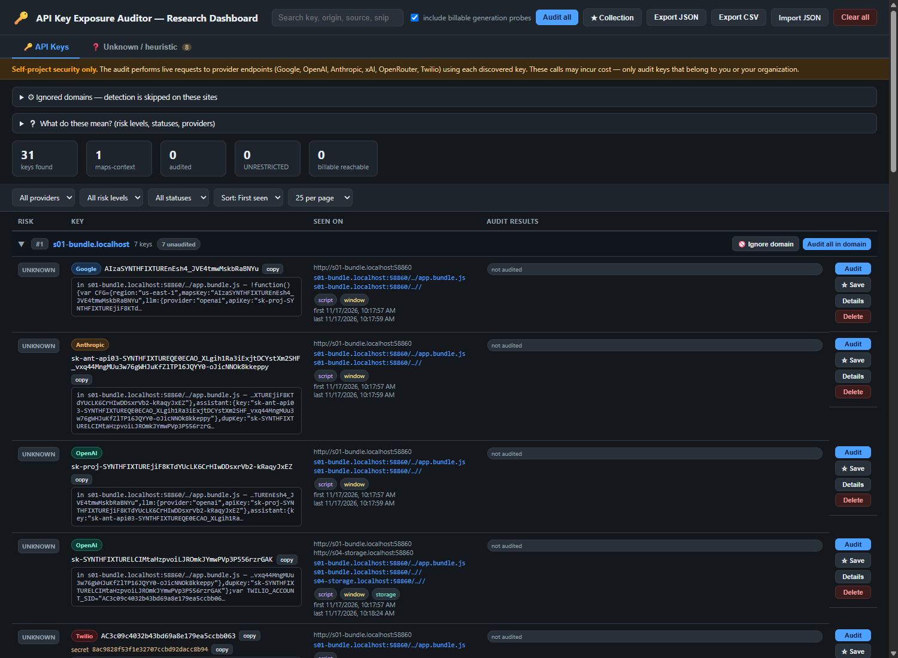
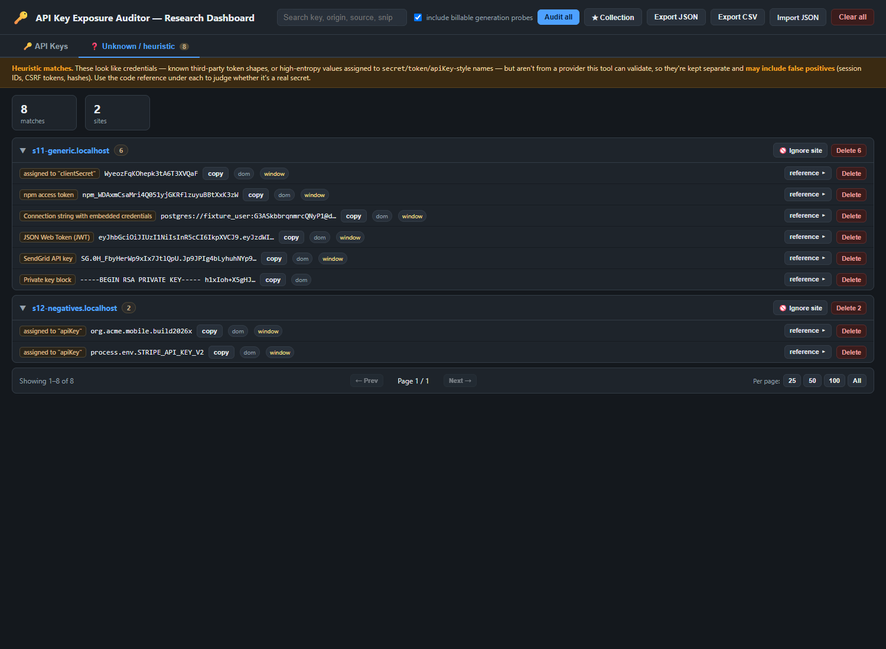
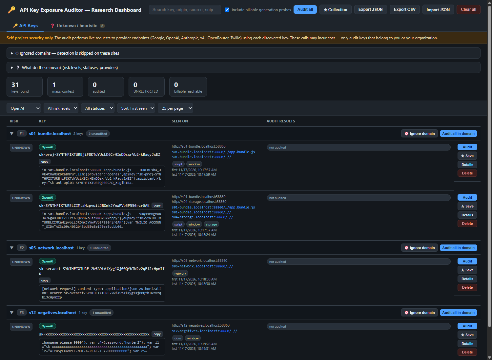

# Case Study 001: Credential exposure across client-side surfaces

Author: Hasif Ahmed (hasif5@gmail.com, www.hasif.info)
Date: 2026-11-17
System under test: API Key Exposure Auditor v1.13.0, git commit `8615110` (extension code unmodified; all work is under `research/`)
Index: [research/README.md](./README.md)

## 1. Summary

This study measures what the extension detects when credentials are exposed through the places front-end projects commonly leak them, and how it behaves on strings that are not credentials. All credentials are synthetic and all traffic stayed on loopback.

Measured results (details and caveats in section 8):

- **Detection, browser run.** 36 of 36 declared exposures were found with the correct provider and through the expected code path. The 36 exposures cover 35 distinct credentials; one key is deliberately placed on two surfaces to test deduplication, and it collapsed to a single record as designed. Twilio and AWS were captured as full pairs.
- **Predicted misses.** 3 of 3 exposures designed to evade a regex scanner were missed, as predicted.
- **False positives.** 0 of 15 structurally invalid strings were flagged. 4 of 4 lookalikes were flagged (a placeholder `sk-xxxx...` value, a Google-format documentation example, an environment-variable reference assigned to `apiKey`, and a reverse-DNS identifier assigned to `apiKey`). Record-level precision on this corpus is 36 of 40 (90.0%). These four are values a human would not call secrets, so they are the practical false-positive surface.
- **Pattern consistency.** Three separate copies of the detection patterns (`lib/providers.js`, `content/patterns.js`, `content/intercept.js`) produced identical results on 143 texts. A deliberate mutation of one copy made the same check report 9 differences, so the check can fail.
- **Risk classification.** 31 of 31 scenarios, using simulated provider responses, matched the expected risk level.
- **Observations.** Five items are recorded in section 9. The most significant is a mismatch between the README and the code about whether billable audit probes are on by default.

These figures describe a small corpus designed by the same party that wrote the harness, with knowledge of the detector. They are conformance results, not estimates of real-world recall or precision. Section 10 lists the limits.

## 2. Objective and scope

Objective: determine, with reproducible evidence, whether the extension's documented detection surfaces work as described, quantify misses and false positives on a controlled corpus, and check that the audit and risk logic behaves as documented.

In scope: passive detection on pages the harness serves; the detector and risk-assessment code paths; the audit probe set (inventory only); the findings database and ignore list.

Out of scope: any real provider endpoint; any real credential; third-party websites; the Chrome Web Store build; performance; the popup UI.

## 3. Authorization and rules of engagement

- The only system tested is software the author owns, running locally.
- Credentials are generated at runtime from a fixed seed (`research/fixtures/synthetic.mjs`). None were ever issued by a provider.
- The fixture server listens on `127.0.0.1`. The browser is launched with a DNS policy in which only loopback names resolve, plus one provider hostname (`maps.googleapis.com`) mapped to loopback for scenario S10. Every other name fails to resolve.
- The live audit feature was not run in the browser. Provider responses used for audit logic are local mocks.
- Evidence is redacted before it is written, and a scanner confirms that no credential-shaped string exists under `research/`.

## 4. Test environment

| Item | Value |
|---|---|
| OS | Windows 11 (10.0.26300) |
| Browser | Chromium `Chrome/149.0.7827.55` (Playwright build), headless (`--headless=new`), extension loaded unpacked |
| Node | v24.22.1 |
| Extension | v1.13.0 (`manifest.json`), commit `8615110` |
| Settle time | 8 seconds per scenario (the extension's content script re-scans at about 0.4, 1.5, 2.5, 4, and 6 seconds) |
| Origins | One per scenario: `http://sNN-name.localhost:<ephemeral port>` |
| Network policy | `--host-resolver-rules=MAP maps.googleapis.com 127.0.0.1, MAP * ~NOTFOUND, EXCLUDE localhost, EXCLUDE *.localhost, EXCLUDE 127.0.0.1` |

## 5. How detection works (from the code)

Read from source before testing, so that expectations were declared against actual mechanisms:

- **Two copies of the patterns plus one in the interceptor.** Content scripts cannot import modules, so `content/patterns.js`, `content/intercept.js`, and `lib/providers.js` each carry the regexes. `CLAUDE.md` calls the duplication intentional and requires keeping them in sync.
- **Boundary guards.** Provider patterns use lookbehind and lookahead so a key must be a complete token (for example `lib/providers.js` lines 19 to 30).
- **Pairs.** Twilio needs an `AC` SID plus a nearby 32-hex token, and only fires when Twilio wording appears within 250 characters (`lib/providers.js` line 591). AWS pairs an Access Key ID with a nearby secret (`awsSecret`, line 396).
- **Surfaces.** The content script scans the serialized DOM, storage, IndexedDB, Cache Storage, resource-timing URLs, and the page URL. A MAIN-world interceptor patches `fetch`, XHR, WebSocket, EventSource, and `sendBeacon`, and serializes enumerable window globals. The service worker fetches linked scripts, follows source maps (`scanSourceMap`, `background.js` line 407), crawls referenced assets to depth 3, probes a fixed list of common config paths (`COMMON_PATHS`, line 55), and listens to `webRequest`.
- **Heuristics.** Non-provider shapes (JWTs, connection strings, PEM blocks, and similar) and keyword assignments are reported under provider `unknown` and are never auto-validated. Assignments are gated by length, charset, a placeholder filter, a letters-plus-digits requirement, and an entropy floor (`looksSecret`, line 674).
- **Audit.** Requests are sent with no Referer and `credentials: 'omit'` (`lib/audit.js` line 135). Bearer-token providers are unconditionally `critical` when valid, because no referrer or IP restriction exists for them.

## 6. Methodology

1. **Ground truth first.** `research/fixtures/scenarios.mjs` declares, per scenario, which credentials are exposed, which stored source tag should find them, and what must not be flagged. Results are compared against that declaration, not against whatever the extension reported.
2. **One surface per origin.** Each scenario is its own origin, which isolates browser storage and the extension's once-per-origin behaviours (config-path probing, header scanning).
3. **Runtime-assembled credentials.** For surfaces that should be found only at runtime (storage, network, globals, request URLs), the page rebuilds the key in the browser from two halves. The served markup never contains the full string, so a hit proves the intended surface, not the DOM scan. A fixture self-check enforces this statically using the extension's own detector (0 problems).
4. **Three result classes.**
   - *Positives*: exposures that should be found.
   - *Known misses*: exposures a regex scanner is not expected to see, declared in advance.
   - *Negatives*: strings that must not be reported, split into *invalid* (structurally not a credential) and *lookalike* (format-valid or keyword-assigned but not secret), so the two failure modes are not mixed.
5. **Scoring.** A positive counts as *detected* if the extension's database holds a record with that key. It counts as *fully correct* if, in addition, the provider is right, a stored source tag matches the expected path, the record's origin is the scenario origin, a pair's secret matches, and (where declared) the exact resource URL matches. One entry uses an exclusive-path check.
6. **Controls.** A mutation control (section 8.3), the known-miss class, the ignored-origin scenario, and the negative corpus each act as a check that the harness can report failure.
7. **Two layers.** The browser run exercises the real extension end to end. The logic run executes the real `lib/` and `content/` code in Node with mocked `chrome` and `fetch`, which allows variant matrices, parity checks, and audit behaviour to be measured without any network access.

## 7. Scenario matrix

| ID | Surface | Expected path (stored tag) | Exposures | Result |
|---|---|---|---|---|
| S01 | External JS bundle, plus a lazy chunk referenced only from the bundle | `script` | 7 (Google, OpenAI, Anthropic, Twilio pair, AWS pair, OpenRouter in chunk, one shared key) | 7/7 |
| S02 | Inline script and an HTML attribute | `dom` | 3 (GitHub, Slack, GitLab) | 3/3 |
| S03 | Source map `sourcesContent` | `sourcemap` | 2 (OpenRouter plain; Stripe with JSON-escaped underscores) | 2/2 |
| S04 | localStorage, sessionStorage, IndexedDB | `storage`, `indexeddb` | 4 (xAI, GitLab, GitHub, and the shared key again) | 4/4 |
| S05 | fetch response, XHR response, request header, request body | `network` | 4 (OpenRouter, Stripe, OpenAI, Google) | 4/4 |
| S06 | `window` globals and `window.name` | `window` | 3 (AWS pair, Twilio pair, Google) | 3/3 |
| S07 | Key inside a base64 config blob | `dom` (decode-and-rescan) | 1 (OpenRouter) | 1/1 |
| S08 | Exposed `/.env` and `/config.json`, never linked from the page | `script` plus exact URL | 3 (Google, Twilio pair, Stripe) | 3/3 |
| S09 | Response header and cookie | `header`, `cookie` | 2 (Anthropic, Slack) | 2/2 |
| S10 | `key=` URL parameter on a detached `Image()` request to a loopback-mapped Google host | `network` (webRequest) | 1 (Google) | 1/1 |
| S11 | Heuristic shapes (SendGrid, JWT, connection string, npm, keyword assignment, PEM block) | `dom`, provider `unknown` | 6 | 6/6 |
| S12 | False-positive corpus | none | 19 strings (15 invalid, 4 lookalike) | see 8.4 |
| S13 | Known limitations | none | 3 | see 8.5 |
| S14 | Origin on the user ignore list | none | 1 | 0 stored |

## 8. Results

### 8.1 Browser end to end

Source: [`evidence/results/browser-results.json`](./evidence/results/browser-results.json), transcript [`evidence/transcripts/browser-run.txt`](./evidence/transcripts/browser-run.txt).

| Measure | Result |
|---|---|
| Scenarios visited | 14 |
| Expected exposures detected | 36 / 36 (35 distinct credentials) |
| Fully correct (provider, path, origin, pair secret, resource URL) | 36 / 36 |
| Wrong provider | 0 |
| Predicted misses actually missed | 3 / 3 |
| Structurally invalid strings flagged | 0 / 15 |
| Lookalikes flagged | 4 / 4 |
| Records in the extension database | 39 (35 distinct credentials plus the 4 lookalikes) |
| Record-level precision on this corpus | 36 / (36 + 4) = 90.0% |
| Ignored-origin credentials stored | 0 / 1 |
| Cross-origin dedup of the shared key | 1 record, origins S01 and S04, sources `script` and `storage` |
| Toolbar badge equals expected distinct-key count | 10 of 11 scenarios with exposures (S09 differs; see finding 3) |

Notes on attribution. The stored source tags sometimes include `window` in addition to the expected tag, for example on S01 (the bundle assigns its config object to a global) and S04 (the window-global scan appears to serialize storage objects). The check only requires the expected tag to be present. The `window` extras were not investigated further.

In S03 the OpenRouter key sits in plain text inside the `.map` file, so the ordinary script scan also finds it (sources `script` and `sourcemap`). The Stripe-shaped key is stored with its underscores JSON-escaped (`\u005f`): the raw map text matches no detector, but the decoded `sourcesContent` does. It was found with source `sourcemap` only, which demonstrates that the map-decoding step adds coverage beyond a raw text scan.

Dashboard captures from the same run:







### 8.2 Detection variants (logic run)

14 credential subjects (12 single-token formats, 2 pairs) were each embedded in up to 9 presentation formats: plain, surrounded by prose, JSON, JavaScript assignment, URL query, HTML attribute, minified, base64-wrapped, and fully percent-encoded. URL query was skipped for the two pairs.

Result: **124 of 124** detected with the correct provider (and correct secret for pairs). Per-format and per-provider tables are in [`logic-results.json`](./evidence/results/logic-results.json), section `B_detectionVariants`.

This section covers provider formats only. Heuristic shapes are covered by the browser run (S11), not by the variant matrix.

### 8.3 Pattern parity and a negative control

The same 143 texts (124 variants plus 19 negatives) were run through the module-world detector, `content/patterns.js` loaded in a sandbox, and `content/intercept.js` executed in a sandbox with its patched `fetch`. All three returned identical key, provider, and secret sets (0 differences).

To show the comparison can fail, an in-memory copy of `patterns.js` was altered (Anthropic minimum length 90 to 91, Stripe `test` to `tst`). The same check then reported 9 differences. The repository files were not touched.

### 8.4 False-positive corpus

Source: scenario S12, scored in both layers.

| Class | Flagged / total | Flagged items |
|---|---|---|
| Invalid (too long, too short, glued to an alphanumeric run, hashes, UUIDs, chunk names, Twilio-shaped SID without Twilio context, low-entropy or placeholder or short assignments) | 0 / 15 | none |
| Lookalike (format-valid or keyword-assigned, not secret) | 4 / 4 | `sk-` followed by 48 `x` characters, reported as OpenAI; a Google-format documentation example (`AIza` plus a 35-character body containing the words EXAMPLE, NOT, A, REAL, KEY), reported as Google; `process.env.<NAME>` assigned to `apiKey`, reported as `unknown` (heuristic); a reverse-DNS identifier assigned to `apiKey`, reported as `unknown` (heuristic) |

All four lookalikes are reported. The two provider-format ones (OpenAI-shaped and Google-shaped) are reported because provider patterns match on shape alone and have no placeholder filter: the Google-shaped value contains the word EXAMPLE and is still reported. The two heuristic ones are reported because the keyword-assignment heuristic accepts any sufficiently long, sufficiently varied value assigned to a name such as `apiKey`, including references and identifiers. Users will see these as false positives in code that documents or wires up keys rather than embedding them.

The placeholder filter (`xxxx`, `your`, `example`, and similar) applies only to the keyword-assignment heuristic. It is why a value containing the word `example` assigned to `apiKey` is dropped (see section 14, the first fixture correction below).

### 8.5 Known misses

Declared before running. All three were missed, as predicted:

| ID | Exposure | Why a regex scanner does not see it |
|---|---|---|
| S13-fragments | Key assembled from two string fragments inside a closure, never stored, sent, or attached to `window` | The full string never exists in scanned text or reachable globals |
| S13-charcodes | Key stored as an array of char codes and rebuilt only inside a closure | Same |
| S13-worker | Literal key in a Web Worker script referenced only from an inline script | The crawler follows asset URLs found inside fetched files and linked scripts, not inside inline script text |

These keys are still shipped to every visitor. The result says the scanner cannot see them, not that they are safe.

### 8.6 Risk classification (simulated responses)

Source: `logic-results.json`, section `E_riskClassification`. The mock responses are written to match the shapes the extension's parsers expect; they are not recordings of real providers.

31 of 31 scenarios matched the expected level. Highlights:

- Valid bearer-style credentials (OpenAI, Anthropic, OpenRouter, xAI, GitHub, GitLab, Slack, Stripe) classify as `critical`; revoked ones as `unknown` with the label "Invalid / revoked key".
- A key rejected on one probe but accepted on another still classifies `critical`.
- Slack answers HTTP 200 with `{"ok":false,"error":"invalid_auth"}`; this was classified invalid, not valid.
- Twilio and AWS with no companion secret make **no network call** and report `inconclusive`.
- Google: invalid everywhere gives `unknown`; referrer-restricted everywhere gives `restricted`; billable Maps reachable gives `critical`; referrer-locked Maps with non-billable Gemini listing still open gives `high` with `bypass` set; a Static Maps HTTP 200 text/plain error body is not counted as enabled.

Two scenarios show behaviour worth reviewing (finding 4).

### 8.7 Audit probe inventory (simulated responses)

For each provider, the real `audit()` function was run against a mock that records every request. Across all runs, 119 requests were issued, all to the expected provider hosts (0 unexpected hosts), all with `referrerPolicy: 'no-referrer'` and `credentials: 'omit'`.

Default mode is `includeGenerate: false`:

| Provider | Probes (default) | Marked billable (default) | Probes (with generate) | Marked billable (with generate) |
|---|---|---|---|---|
| Google | 34 | 25 | 37 | 28 |
| OpenAI | 3 | 1 (Embeddings) | 6 | 4 |
| xAI | 2 | 1 (Embeddings) | 3 | 2 |
| Anthropic | 2 | 0 | 3 | 1 |
| OpenRouter | 3 | 0 | 4 | 1 |
| Twilio, AWS, GitHub, GitLab, Slack, Stripe | 1 to 6 | 0 | same | 0 |

"Billable" is the extension's own `billable` flag on each probe record. Cost figures are the extension's indicative notes, not measured charges.

### 8.8 Network containment

Evidence that nothing left the machine:

| Measure | Value |
|---|---|
| Requests attempted by all attached pages and the service worker | 128 in the committed run (varies by a few between runs with timing) |
| Distinct hosts attempted | 16: the 14 scenario origins, the extension's own `chrome-extension://` host, and `maps.googleapis.com` (loopback-mapped) |
| Non-loopback hosts attempted | 0 |
| Network loading failures | 0 |
| Fixture-server requests addressed to a host other than a scenario origin or the mapped provider name | 0 |
| Requests answered by the loopback sink for the provider name (S10) | 1 |

## 9. Findings and observations

None of these is a vulnerability in a third-party system. They concern this project's behaviour and documentation.

**1. Documentation and code disagree on billable audit probes.**
At the audited commit (`8615110`), README line 133 said the default audit run uses free access checks and that billable generation probes are opt-in. In the code, the dashboard checkbox is rendered checked (`dashboard/dashboard.html` line 15, `id="genChk" checked`) and the popup defaults it on (`popup/popup.js` line 63, `s.gaks_gen !== false`). Separately, even with generation probes off, 25 of Google's 34 probes and the OpenAI and xAI Embeddings probes carry the extension's own `billable: true` flag (section 8.7). The dashboard screenshot above shows the box checked in a fresh profile.
Impact: a user following the README may trigger billable requests against their own key without intending to. The dashboard does show a confirmation dialog and a warning banner.
Recommended remediation: default the checkbox off, correct the README text, or relabel what "default" means for Google, OpenAI, and xAI.
Status (2026-11-17): the README text was corrected in the working tree after this study, so that it now says the option is on by default and should be unticked for free-only checks. The extension's default was deliberately not changed. Whether to default the checkbox off remains an open product decision. The measurements above were taken against the extension code, which is unchanged.

**2. The audit consent gate is enforced only in the UI.**
The popup disables the Audit button until the acknowledgment box is ticked (`popup/popup.js` lines 218 and 283) and the dashboard shows a confirm dialog (`dashboard/dashboard.js` lines 156 to 159). The service-worker handlers for `GAKS_AUDIT` and `GAKS_AUDIT_RAW` (`background.js` lines 302 and 309) contain no consent check. The manifest has no `externally_connectable` entry, so web pages cannot reach those handlers directly. Impact is limited to other extension contexts.
Recommended remediation (optional, defence in depth): record consent in the worker and refuse audit messages without it.

**3. Per-tab badge can miss header and cookie findings.**
For scenario S09 both findings were stored, but the toolbar badge was empty in the standard run and showed 1 (not 2) when the tab was opened directly on the URL (probe files `probe-aboutblank-S09.json` and `probe-directnav-S09.json`). `background.js` clears a tab's key set when `tabs.onUpdated` reports `loading` with a URL (line 494), while header and cookie hits are recorded earlier, during `onHeadersReceived`. That ordering is a plausible cause. It was not confirmed by instrumentation.
Impact: a key found only in a response header or cookie may be in the dashboard but not in the badge or popup.
Recommended remediation: confirm the ordering and, if it holds, record these hits after the navigation-start reset.

**4. Two risk-classification edge cases (simulated responses).**
HTTP 403 is classified `invalid-key` (`bearerClassify`, `lib/providers.js` line 59), so a valid key that lacks permission on every probe is labelled "Invalid / revoked key". HTTP 429 with an exceeded-quota message is classified `over-quota`, but the bearer assessor then reports level `unknown` with the label "Not reachable", although the key authenticated.
Impact: possible under-reporting of a live exposed key. This rests on mocked responses; real provider behaviour was not tested.
Recommended remediation: treat over-quota as a valid key, and distinguish permission errors from invalid-key errors where the provider's error body allows it.

**5. Format-valid placeholders and identifier-like assignments are flagged.**
See section 8.4. This is an inherent limit of pattern matching. The dashboard already labels heuristic matches as possibly containing false positives. A provider-format placeholder such as an all-`x` OpenAI-shaped value appears in the main findings list, not the heuristic tab, until it is audited.
Recommended remediation: optionally add a low-entropy or repeated-character filter to provider patterns.

Positive observations: boundary guards rejected all 15 structurally invalid strings; pair association and the no-call behaviour for incomplete pairs worked; deduplication across origins worked; the user ignore list suppressed storage; and three independent pattern copies agreed on every tested input.

## 10. Limitations

- **Self-evaluation.** The fixtures and the harness were written with knowledge of the detector. The corpus is small (36 exposures, 19 negatives, 124 variant trials). Percentages are conformance figures, not real-world recall or precision.
- **Environment.** One OS, one Chromium build, headless, 8-second settle time.
- **Simulated audit.** Risk and probe results use local mocks. Real provider responses, rate limits, and restriction behaviour were not tested, and no real key was audited.
- **Not exercised.** WebSocket, EventSource, and `sendBeacon` interception (patterns covered by the parity test only); Cache Storage; shadow DOM; `<template>`; URL fragments; the built-in ignore defaults; webRequest `Authorization` and `x-api-key` sniffing on provider hosts; cross-origin iframes; pages behind authentication.
- **Attribution.** Source tags are the extension's own labels. Extra `window` tags were observed and not investigated.
- **Untested code reading.** The content script forwards `window.postMessage` messages of type `__GAKS_NET_FINDING__` from the page (`content/content.js` line 293) after checking only that the source is the window itself. Whether a hostile page could use this to inject false findings was not tested.
- **Finding 3** is an observation with a plausible, unconfirmed cause.

## 11. Remediation guidance for developers

For credentials of the kinds this class of tool finds in your own projects:

1. **Treat anything shipped to a browser as public.** Bundles, source maps, `window` config, storage, and responses are all readable by every visitor. Obfuscation (fragments, char codes) hides a key only from scanners.
2. **Move secrets server-side.** Call provider APIs from a backend or proxy that holds the key. Bearer-style provider keys (OpenAI, Anthropic, OpenRouter, xAI, GitHub, Slack, Stripe secret keys) cannot be restricted by referrer or IP, so any exposure of a valid key is a full compromise of that key.
3. **Where a key must be public (for example a maps browser key), restrict it.** Apply HTTP-referrer or IP restrictions and limit it to the specific APIs it needs, then verify the restriction from outside.
4. **Rotate on exposure.** Revoke and reissue first; investigate usage afterwards.
5. **Do not ship secrets in source maps.** Disable `sourcesContent` in production builds or do not publish maps. Check that `/.env`, `/config.json`, and similar paths return 404.
6. **Keep credentials out of web storage and response headers.** Use short-lived, scoped tokens issued per session.
7. **Add secret scanning to CI** and to pre-commit hooks so keys are caught before a build ships them.

## 12. Reproduction

See [research/README.md](./README.md#reproduce). In short:

```bash
node research/harness/logic.mjs
node research/harness/browser.mjs
node research/harness/scan-leaks.mjs
```

## 13. Evidence index

| File | Contents |
|---|---|
| [`evidence/results/browser-results.json`](./evidence/results/browser-results.json) | Per-exposure scoring, negatives, known misses, badges, containment figures, redacted database snapshot |
| [`evidence/results/logic-results.json`](./evidence/results/logic-results.json) | Sections A to G: self-check, variants, parity, negative control, false-positive corpus, risk scenarios, probe inventory, audit-gate source facts |
| [`evidence/results/probe-aboutblank-S09.json`](./evidence/results/probe-aboutblank-S09.json), [`probe-directnav-S09.json`](./evidence/results/probe-directnav-S09.json) | Finding 3 probes |
| [`evidence/screenshots/`](./evidence/screenshots/) | Three dashboard captures |
| [`evidence/transcripts/`](./evidence/transcripts/) | Console output of the last full logic and browser runs |

## 14. Corrections made during the study

Recorded so the final numbers can be read in context. Every correction below fixed a fixture or harness defect found by checking a result against its declared intent; none edited a detector, an assertion, or a pass criterion. The first correction below changed which lookalike results the study reports, so it is stated in full.

- Two lookalike fixture items did not test what their labels claimed, found while verifying the explanation for why they were not flagged. The "Google-format documentation example" had a 33-character body where the pattern needs 35, so it was never format-valid. The "reverse-DNS identifier" contained the word `example`, which the placeholder filter rejects, so it never exercised the entropy and charset gates. The first full run therefore reported 2 of 4 lookalikes flagged (94.7% precision). The first draft of this document also contained an unverified explanation of the Google miss; it was removed. Both fixtures were corrected to match their labels (35-character body; identifier without placeholder words), the logic and browser runs were repeated, and the corrected result is 4 of 4 (90.0%). The less favourable number is the accurate one.
- The first browser run reported 35 of 36 detected. The miss was a ground-truth error in the fixture: the connection-string pattern stops before the URL path, so the stored key was shorter than the string the fixture expected. The fixture was corrected to end at the port, and the corrected run reported 36 of 36.
- The first version of the logic false-positive check tested negatives as bare strings without their assignment context, which under-counted lookalikes. It now tests the exact embedded snippet the browser run serves. Both layers agree.
- Source-map attribution was initially ambiguous because the raw `.map` text already contains the key. The Stripe-shaped key is now JSON-escaped in the map so that only decoding can find it, and the fixture self-check proves the raw text is invisible to the detector.
- The first harness version printed a badge key count that was always `null` (a service worker cannot message its own listener). That field was removed.
- Evidence snippets originally contained neighbouring full synthetic keys. A scrubber now redacts any detector hit in every string written to evidence, and the leak scanner confirms zero hits under `research/`.
- One lookalike literal in `scenarios.mjs` itself triggered the extension's heuristic; it is now assembled at runtime.
- GitHub push protection rejected the first push because four evidence snippets in `browser-results.json` contained the S12 "Twilio-shaped SID without Twilio context" negative as neighbouring text. The extension's detector ignores a bare SID by design, so the scrubber and leak scanner, which both rely on that detector, missed it. Both now also match bare SID shapes (`BARE_SHAPES` in `scrub.mjs`), the scanner reproduced the four hits before the fix and reports zero after it, and both harnesses were re-run to regenerate the evidence. Detection results were unchanged. The values are synthetic; they were redacted because a public repository should not carry strings that real secret scanners flag.
